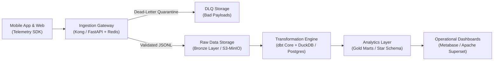

# 01 — EXECUTIVE SUMMARY: VELOOP PRODUCT ANALYTICS FOUNDATION

> **MANDATORY DATA AUTHENTICITY NOTICE**  
> *VELOOP is a real product under development, but the data supplied and evaluated for this assignment is fictional/simulated for analytical testing. In accordance with the Data Authenticity Policy, no metric or finding herein represents actual VELOOP production statistics, actual earnings, actual withdrawals, or live business performance.*

---

## 1. Executive Context & Analytical Mandate
VELOOP Rewards is actively developing an online rewards and gamified user engagement ecosystem encompassing task completion (video ads, surveys, micro-earning tasks, cloud mining claims), multi-tiered gamification (streaks, spin wheels, quests, badges, levels), a viral referral network, and a multi-currency double-entry ledger supporting cash redemptions and token exchanges.

Currently, VELOOP does not possess the volume of mature production telemetry required for conventional post-hoc analytics. This project executes **Task 01: Product Analytics, Data Readiness & Data Management Blueprint** across 25 working days of structured product discovery. Rather than manufacturing vanity metrics, our mandate was to **engineer the complete analytical foundation**: defining what to track, how to model it, how to ensure data trustworthiness, what management should measure, what engineering must instrument, and what the future analytics organization will consume.

---

## 2. Scope of Investigation
The analytical investigation covered 8 operational work streams across 14 functional product modules:

1. **Product Area Mapping & Boundary Identification**: Systematically decomposed user actions, system actions, and business outcomes across User Registration, Onboarding, Task Discovery, Video Ads, Surveys, Tap & Earn, Cloud Mining, Daily Check-ins, Streak Protection, Spin Wheel, Quests, Badges, Referrals, Wallet Ledger, and Withdrawal Rails.
2. **User Identity & Lifecycle Specification**: Evaluated surrogate identifier mechanics (`user_id`, `session_id`, `event_id`, `transaction_id`) to maintain referential integrity without capturing unnecessary Personally Identifiable Information (PII).
3. **Earning & Reward Decoupling**: Audited the fundamental separation between *activity occurrence* (task execution) and *reward issuance* (ledger credit), modeling multi-state lifecycles for third-party network postbacks and delayed escrows.
4. **Financial Ledger & Withdrawal Integrity**: Formulated a double-entry transaction model for platform currencies (VEs, Gems, Tokens) and mapped the multi-stage withdrawal lifecycle (`requested` → `under_review` → `processing` → `completed` / `rejected` / `reversed`).
5. **Simulated Dataset Profiling**: Executed automated statistical and referential integrity profiling across 8 synthetic data tables totaling 30,150 records (`Users`: 1,000; `Task_Activity`: 6,000; `Rewards`: 5,000; `Wallet`: 3,500; `Withdrawals`: 1,200; `Referrals`: 900; `Feature_Events`: 12,000; `Messy_Data`: 550).
6. **Data Quality & Anomaly Audit**: Deep-audited an intentionally corrupted data partition (`Messy_Data`) to detect, categorize, quantify, and design prevention controls for 14 structural defect classes.
7. **Production Event Tracking & Data Dictionary Architecture**: Formulated a canonical `domain_object_action` naming taxonomy, cataloging 30 production-ready events with full payloads, and established a 92-field technical data dictionary.
8. **End-to-End Analytics Operating Model**: Designed a practical, scalable, open-source-first medallion architecture (Bronze/Silver/Gold) on PostgreSQL/DuckDB/dbt with role-based access control (RBAC).

---

## 3. Key Findings & Critical Discoveries

```
+----------------------------------------------------------------------------------------------------+
|                                     KEY ANALYTICAL DISCOVERIES                                     |
+-----------------------------------+----------------------------------+-----------------------------+
| 1. Decoupling Void                | 2. Identity & Idempotency Deficit| 3. State Machine Integrity  |
| Task activity and reward credits  | Lack of client event UUIDs and   | Withdrawal events frequently|
| were conflated in early specs;    | session tokens causes rapid      | lack terminal state records,|
| third-party ad networks require   | duplicate tap bursts and breaks  | risking escrow lockups and  |
| asynchronous postback tracking.   | multi-touch session attribution. | unrefunded balances.        |
+-----------------------------------+----------------------------------+-----------------------------+
| 4. Data Quality Vulnerabilities   | 5. Financial Unit Economics      | 6. Referral Attribution Lag |
| Audit detected 14 distinct error  | Without gross ad CPM postback    | Registration does not equal |
| classes in unvalidated feeds      | ingestion, net margin per user   | conversion; bot signups must|
| (orphans, negative amounts, etc). | cannot be calculated.            | be filtered via task gates. |
+-----------------------------------+----------------------------------+-----------------------------+
```

### Discovery A: Decoupling Task Completion from Ledger Crediting
In initial architectural assumptions, task completion was treated as synonymous with balance incrementation. Our analysis proved that this assumption creates catastrophic financial vulnerability. Third-party ad networks (AdMob, IronSource) and survey routers (Pollfish, Tapjoy) frequently suffer postback delays, dropped webhooks, or chargeback reversals. Telemetry must explicitly track `task_completed` as a verification event and `reward_credited` as an independent ledger event linked via `task_activity_id`.

### Discovery B: Identity and Idempotency Gaps
Profiling revealed that without a client-generated UUID `event_id` and strict server-side idempotency cache, network retries and UI button double-taps produce duplicate reward transactions. Furthermore, anonymous mobile sessions lacking a stable `session_id` render session duration and bounce-rate KPIs uncomputable.

### Discovery C: Data Quality Vulnerabilities in Raw Feeds
Our forensic audit of the `Messy_Data` sheet uncovered widespread vulnerabilities:
- **Critical Severity**: 45 orphan records referencing non-existent users, 25 missing user IDs, 22 non-numeric strings in financial amount fields, and 40 impossible state transitions (e.g., withdrawals completed prior to submission).
- **High Severity**: 140 duplicate records, 34 missing timestamps, 26 malformed dates, and 30 negative requested withdrawal amounts.
- **Root Cause**: Absence of strict schema validation at the client SDK and API ingestion gateway.

### Discovery D: Incalculable Strategic KPIs in Current Schemas
The KPI Calculability Assessment demonstrated that while operational activity metrics (DAU, Task Completion Rate, Turnaround Time) are fully computable, core economic metrics—such as **Net Ad Revenue per User (ARPU)** and **Multi-Account Sybil Collusion Rate**—are completely blocked because third-party gross ad revenue settlement feeds and hardware device fingerprints are not ingested into the data lake.

---

## 4. Current Unknowns & Technical Ambiguities
Through the formal **Assumption & Verification Register (WP S)**, we isolated 10 high-risk unknowns that require cross-functional engineering and executive resolution:

1. **Third-Party Postback Architecture**: Are video ad completions validated on the client SDK or via authenticated server-to-server (S2S) postback webhooks?
2. **Economic Exchange Peg**: What is the authoritative monetary exchange rate between earned VEs, secondary Tokens, and fiat withdrawal currencies (e.g., USD)?
3. **Client Offline Queueing & Timestamp Drift**: Does the mobile SDK buffer events offline, and what is the maximum permissible clock drift between client `timestamp` and server `ingested_at`?
4. **KYC & Payout Escalation Rules**: What is the exact monetary threshold requiring identity verification prior to withdrawal release?
5. **Deduplication Cache Duration**: What is the TTL (Time-To-Live) window for Redis idempotency keys at the API gateway (recommended: 48 hours)?

---

## 5. Architectural Blueprint & Recommended Implementation
To ensure production readiness, VELOOP must construct a modern, cost-effective data foundation organized into four distinct tiers:



1. **Ingestion Contract Gatekeeper**: Deploy JSON Schema validation and idempotency checking at the API gateway layer to reject malformed records, strip whitespace, and normalize casing before database writes.
2. **Medallion Data Lakehouse**:
   - **Bronze (Raw)**: Immutable append-only storage for raw event payloads and ingestion metadata (`ingested_at`, `payload_hash`).
   - **Silver (Cleaned & Conformed)**: Type-cast, deduplicated, and referentially verified relational tables with CDC tracking.
   - **Gold (Dimensional Marts)**: Star-schema fact and dimension models supporting sub-second BI querying.
3. **Double-Entry Ledger Standard**: Enforce immutable journal entries for every credit, debit, and escrow hold with strict check constraints (`amount > 0` for unsigned actions; non-negative running balances).
4. **Finite State Machine (FSM) Governance**: Prevent impossible state progressions in withdrawals and tasks by enforcing transactional transition gates.

---

## 6. Major Strategic & Operational Risks

| Risk Domain | Risk Description | Business Impact | Mitigation Strategy |
| :--- | :--- | :--- | :--- |
| **Financial / Economic** | Points inflation without ad revenue backing; duplicate reward disbursement. | Run-on-the-bank liquidity crisis; platform insolvency. | Atomic double-entry ledger; S2S gross ad revenue reconciliation; 72h escrow on high-value offers. |
| **Data Integrity** | Dirty telemetry entering BI dashboards; orphan records skewing retention cohorts. | Misguided executive decisions; loss of stakeholder trust. | Multi-tier validation (SDK → Gateway → dbt test suite); automated dead-letter quarantines. |
| **Fraud & Exploitation** | Multi-account bot farms automating tasks and recycling referral links. | Payout draining by bad actors; ad network partnership bans. | Hardware device fingerprinting; IP ASN screening; referee first-task activation gating. |
| **Regulatory & Privacy** | Accidental ingestion of payment tokens, PII, or raw passwords into data warehouse. | GDPR/CCPA fines; severe reputational damage. | Strict data classification (Public, Internal, Restricted); field-level tokenization; RBAC masking. |

---

## 7. Prioritized Implementation Roadmap

```
+----------------------------------------------------------------------------------------------------+
|                                    PHASED IMPLEMENTATION TIMELINE                                  |
+-----------------------------------+----------------------------------+-----------------------------+
| PRE-LAUNCH: SPRINT 1-2 (WEEKS 1-4)| PRE-LAUNCH: SPRINT 3-4 (WEEKS 5-8)| POST-LAUNCH: WEEKS 9-16    |
| - Stable User ID & Ledger Txn ID  | - Ingestion Gateway Validation   | - Gold Mart BI Dashboards   |
| - Telemetry SDK & Event Contracts | - dbt Silver Transformation Core | - Sybil Anti-Fraud Models   |
| - Withdrawal FSM & Escrow Rails   | - Referral Activation Engine     | - Real-time Anomaly Alerts  |
+-----------------------------------+----------------------------------+-----------------------------+
```

1. **Critical Pre-Launch Mandates (Weeks 1–4)**:
   - Implement immutable `user_id` and double-entry `transaction_id` models.
   - Deploy standardized client tracking SDK enforcing UUID `event_id` and ISO 8601 timestamps.
   - Instrument strict withdrawal state machine preventing payout execution without verified review.
2. **High-Priority Readiness Mandates (Weeks 5–8)**:
   - Deploy API gateway schema validator with dead-letter queue routing.
   - Build automated dbt Bronze-to-Silver transformation pipelines and referential integrity testing.
   - Implement referral activation gating requiring verified task completion prior to bonus crediting.
3. **Post-Launch Scale Mandates (Weeks 9–16)**:
   - Release the 7 operational BI dashboards (Executive, User, Engagement, Rewards, Wallet, Withdrawals, Referrals).
   - Ingest gross ad network settlement revenue to enable true net-margin ARPU reporting.
   - Deploy automated alerting on statistical metric deviations (reversal spikes, withdrawal queue delays).

---
*Deliverable Document Reference: `docs/01_EXECUTIVE_SUMMARY.md` | Prepared for VELOOP Engineering & Product Leadership.*
