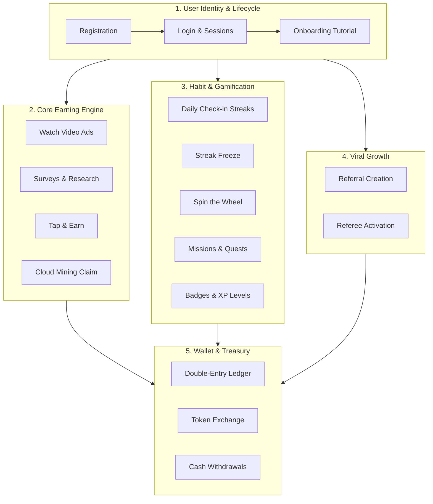

# 02 — WORK PACKAGE A: PRODUCT DATA READINESS AUDIT

> **MANDATORY DATA AUTHENTICITY NOTICE**  
> *VELOOP is a real product under development, but the data supplied and evaluated for this assignment is fictional/simulated for analytical testing. In accordance with the Data Authenticity Policy, no metric or finding herein represents actual VELOOP production statistics, actual earnings, actual withdrawals, or live business performance.*

---

## 1. Executive Objective & Scope
The primary objective of the **Product Data Readiness Audit (Work Package A)** is to establish a comprehensive mapping of every product feature, user action, system action, and business outcome across the developing VELOOP Rewards ecosystem. This audit establishes the structural blueprint of what data VELOOP will eventually need to operate at scale and identifies the critical analytical blind spots that currently threaten production reporting.

---

## 2. Product Area & Boundary Deconstruction

VELOOP Rewards integrates 14 core operational product areas:



---

## 3. The Tripartite Event Model: User vs System vs Business Outcome

A foundational flaw in early analytics architectures is treating all events as "user actions." In a reward and ledger platform, telemetry must be rigorously segregated into three distinct categories:

```
+---------------------------------------------------------------------------------------------------------+
|                                  THE TRIPARTITE DATA MODEL HIERARCHY                                    |
+------------------------------------+-----------------------------------+--------------------------------+
| 1. USER EVENT (Client / SDK)       | 2. SYSTEM EVENT (Backend Core)    | 3. BUSINESS OUTCOME (Ledger/BI)|
| Direct behavioural interaction:    | Internal computational transition:| Macro commercial consequence:  |
| - Clicks "Watch Ad"                | - Verifies video completion proof | - Ad CPM revenue accrued       |
| - Submits withdrawal form          | - Validates fraud heuristics      | - Platform liability decreased |
| - Shares referral deep-link        | - Dispatches payment batch API    | - Verified user acquired (CAC) |
+------------------------------------+-----------------------------------+--------------------------------+
```

### Comparative Analysis Table

| Product Module | User Event | System Event | Business Outcome |
| :--- | :--- | :--- | :--- |
| **Watch Ads** | `task_ad_started` (User initiates video) | `task_ad_validated` (AdMob postback verified) | Impression monetized; micro-VE liability created |
| **Surveys** | `task_survey_started` (User enters survey wall) | `survey_completion_callback_received` | High-value affiliate commission earned |
| **Daily Streak** | `daily_reward_claim_tapped` | `streak_counter_incremented` | Habit reinforced; D7 cohort retention preserved |
| **Withdrawal** | `withdrawal_form_submitted` | `escrow_balance_locked` & `fiat_batch_sent` | Cash liquidated; platform liability redeemed |
| **Referrals** | `referral_invite_shared` | `referee_first_task_validated` | Viral organic user acquired at zero ad CAC |

---

## 4. Comprehensive Product Area Mapping

| Product Area | Feature / Module | User Action | System Action | Business Outcome | Required Data Attributes | Business Question Answered | Status |
| :--- | :--- | :--- | :--- | :--- | :--- | :--- | :--- |
| **User Accounts** | Registration | Submits form / OAuth | Creates user record, initializes ledger balance | New account created | `user_id`, `reg_ts`, `reg_source`, `device_platform`, `country` | Which acquisition channels deliver highest initial signups? | Confirmed |
| **User Accounts** | Authentication | Logs into application | Issues JWT token, updates `last_login_timestamp` | Active session established | `user_id`, `session_id`, `login_ts`, `app_version` | What is the DAU, WAU, and login frequency per cohort? | Confirmed |
| **User Accounts** | Onboarding | Swipes intro screens | Records progress milestones, sets completion flag | Onboarding drop-off reduced | `user_id`, `step_number`, `duration_seconds`, `is_completed` | Where do new users drop off before starting their first task? | Proposed |
| **Earning** | Video Ads | Watches rewarded ad | Requests ad stream, verifies partner postback | Ad revenue generated | `user_id`, `task_activity_id`, `provider`, `duration`, `amount` | What is the ad completion rate and yield per active user? | Confirmed |
| **Earning** | Surveys | Fills screening questions | Redirects to router, awaits webhook callback | Research revenue earned | `user_id`, `task_activity_id`, `provider_id`, `val_status`, `amount` | What proportion of surveys suffer screening dropouts? | Confirmed |
| **Earning** | Tap & Earn | Rapidly taps widget | Decrements energy, computes reward batch | Micro-session engagement | `user_id`, `session_id`, `taps_count`, `energy_used`, `amount` | Does tap activity drive sustained retention or rapid churn? | Proposed |
| **Earning** | Cloud Mining | Starts 6-hour cycle | Sets countdown timer, calculates yield formula | Re-engagement habit formed | `user_id`, `cycle_id`, `start_ts`, `claim_ts`, `yield_amount` | How many users claim within 1 hour of cycle maturity? | Proposed |
| **Daily Rewards** | Check-in Calendar | Taps daily claim card | Validates 24h eligibility, updates streak count | Habitual daily retention | `user_id`, `streak_day`, `reward_amount`, `streak_freeze_used` | What is the drop-off rate between Day 3 and Day 7 streaks? | Confirmed |
| **Gamification** | Lucky Spin Wheel | Taps spin button | Runs server RNG, determines prize segment | Variable reward excitement | `user_id`, `spin_id`, `ticket_type`, `prize_tier`, `prize_amount` | Does minigame engagement cannibalize core task completion? | Confirmed |
| **Gamification** | Quests / Missions | Completes multi-step task | Evaluates criteria counters, unlocks bonus | Cross-feature exploration | `user_id`, `mission_id`, `criteria_met`, `bonus_amount` | Which quest designs drive fastest completion velocity? | Proposed |
| **Gamification** | Badges & XP Levels | Accumulates activity XP | Increments level tier, boosts earning multiplier | Status investment & loyalty | `user_id`, `prev_level`, `new_level`, `total_xp`, `boost_pct` | Does leveling up correlate with higher lifetime user retention? | Proposed |
| **Referrals** | Link Creation | Taps share button | Encodes user referral token into deep-link | Viral loop initiated | `referral_id`, `referring_user_id`, `channel`, `created_ts` | Which social channels generate highest viral click-throughs? | Confirmed |
| **Referrals** | Referral Conversion | Referee completes task | Checks fraud rules, flags converted, pays bounty | Verified active user added | `referral_id`, `referring_uid`, `referred_uid`, `task_id`, `bonus` | What is the conversion lag from registration to activation? | Confirmed |
| **Wallet** | Token Exchange | Converts VEs to Tokens | Applies peg rate, executes atomic double-entry | In-app liquidity provided | `user_id`, `txn_id`, `source_unit`, `target_unit`, `rate` | What ratio of earned VEs are swapped vs held in balance? | Confirmed |
| **Withdrawals** | Payout Request | Submits cash-out form | Checks minimum balance, locks funds in escrow | Redemption pipeline entered | `withdrawal_id`, `user_id`, `amount`, `method`, `fee` | What is the demand distribution across payout rails? | Confirmed |
| **Withdrawals** | Compliance Review | None (Ops / Risk engine) | Runs AML/fraud checks, approves or flags | Risk & fraud blocked | `withdrawal_id`, `user_id`, `risk_score`, `reviewer_id` | What percentage of withdrawals require manual fraud review? | Confirmed |
| **Withdrawals** | Settlement | Receives external funds | Triggers gateway transfer, confirms settlement | Payout fulfilled; trust built | `withdrawal_id`, `user_id`, `tx_hash`, `duration_seconds` | What is the end-to-end SLA from request to disbursement? | Confirmed |

---

## 5. Critical Analytics Gaps (Top 10+ Production Blind Spots)

The data audit revealed **12 major analytics gaps** that currently impair production reporting and economic governance:

```
+---------------------------------------------------------------------------------------------------------+
|                                     TOP ANALYTICS GAPS IDENTIFIED                                       |
+-----+----------------------------------+----------+-----------------------------------------------------+
| GAP | Gap Description                  | Severity | Operational / Strategic Impact                      |
+-----+----------------------------------+----------+-----------------------------------------------------+
| G01 | Decoupling Deficit               | Critical | Task completions and rewards conflated; no postback |
|     |                                  |          | error tracking or partner reconciliation.           |
| G02 | Missing Idempotency Key          | Critical | Client double-taps cause duplicate reward credits.   |
| G03 | Absence of Stable Session ID     | High     | Session duration and bounce rate impossible to track|
| G04 | Third-Party Gross Revenue Void   | Critical | True net margin per user (ARPU) cannot be calculated|
| G05 | Anonymous Pre-Auth Leakage       | High     | Onboarding funnel events lost before user login.    |
| G06 | State Machine Transition Bypass  | Critical | Withdrawals complete without recorded request timestamps|
| G07 | Device Hardware Telemetry Void   | High     | Multi-account bot rings undetectable.               |
| G08 | Delayed Escrow Tracking Deficit  | High     | Chargeback reversals leave user balances negative.  |
| G09 | Unstandardized Event Naming      | Medium   | Mixed casing ('watch-ad' vs 'watch_ad') splits BI.  |
| G10 | Referral Funnel Conflation       | High     | Registration counted as conversion, inflating CAC.  |
| G11 | Lack of Dead-Letter Quarantine   | High     | Malformed telemetry silently crashes ingestion jobs.|
| G12 | Breakage / Dormancy Blindness    | Medium   | Outstanding wallet liabilities overstated in treasury|
+-----+----------------------------------+----------+-----------------------------------------------------+
```

### Detailed Gap Evaluation

#### Gap 01: Decoupling Deficit Between Task Occurrence and Balance Crediting
- **Defect**: Assuming that a task status of `completed` automatically equals a posted reward.
- **Consequence**: When third-party ad networks drop postbacks or survey providers disqualify users post-facto, the platform either under-rewards users (destroying trust) or dispenses unbacked points (destroying margin).
- **Remedy**: Implement independent `Task_Activity` and `Rewards` entities linked via `task_activity_id`.

#### Gap 02: Client Idempotency Key Deficit
- **Defect**: Telemetry payloads lack a client-generated UUID `event_id` and rely on auto-incrementing server IDs.
- **Consequence**: Network retries or impatient user double-clicks generate duplicate reward events in the database.
- **Remedy**: Mandate UUID v4 `event_id` generated on the mobile device and enforced via a 48-hour Redis idempotency cache at the API gateway.

#### Gap 03: Absence of Persistent Session Identifier
- **Defect**: Events are emitted with `user_id` and `timestamp`, but lack a unique `session_id`.
- **Consequence**: Analysts cannot group events into distinct user visits, making Average Session Duration, Bounce Rate, and Events-Per-Session uncomputable.
- **Remedy**: SDK must generate a `session_id` upon app foregrounding, rotating after 30 minutes of inactivity.

#### Gap 04: Third-Party Gross Settlement Revenue Void
- **Defect**: VELOOP records the internal points issued (`reward_amount`), but does not capture the gross dollar earnings received from AdMob, Tapjoy, or Pollfish.
- **Consequence**: The CFO and Product Managers cannot compute Net Contribution Margin, Gross Margin, or Return on Ad Spend (ROAS).
- **Remedy**: Integrate automated S2S daily revenue ingestion feeds from ad networks into the raw data lake.

#### Gap 05: Anonymous Pre-Authentication Funnel Leakage
- **Defect**: Events generated before login or during initial onboarding omit `user_id` or crash telemetry scripts.
- **Consequence**: 100% of top-of-funnel drop-off prior to registration is invisible to marketing.
- **Remedy**: Introduce an `anonymous_device_id` that is aliased to the permanent `user_id` upon registration completion.

#### Gap 06: Withdrawal State Machine Transition Bypasses
- **Defect**: Payouts occasionally transition directly from `requested` to `completed` without logging intermediate review stages or transaction hashes.
- **Consequence**: Payout delays cannot be diagnosed (is it internal review lag or payment provider latency?).
- **Remedy**: Enforce strict database state transitions with mandatory timestamps for every lifecycle stage.

#### Gap 07: Device Hardware Telemetry Void
- **Defect**: Telemetry records operating system (`Android`, `iOS`), but omits hardware identifiers (GAID, IDFV, device model, rooted/jailbroken flag).
- **Consequence**: Fraudulent bot farms running emulator farms cannot be clustered or banned.
- **Remedy**: Add a non-PII security context object (`device_fingerprint_hash`, `is_emulator`, `ip_asn`) to telemetry headers.

#### Gap 08: Delayed Escrow Tracking Deficit on High-Yield Offers
- **Defect**: Points for large offerwall completions are credited immediately rather than placed in an escrow hold.
- **Consequence**: Users immediately withdraw cash before the affiliate network discovers fraud and reverses the commission, generating an unrecoverable loss.
- **Remedy**: Create a `reward_pending` state with automated 72-hour holding escrows for high-value completions.

#### Gap 09: Unstandardized Event Naming Conventions
- **Defect**: Historical client builds mix casing and syntax (`watch-ad`, `WATCH_ADS`, `WatchAd`).
- **Consequence**: SQL aggregation queries fragment metric reporting, undercounting ad views.
- **Remedy**: Enforce a strict `domain_object_action` snake_case taxonomy with CI/CD linting checks.

#### Gap 10: Referral Funnel Stage Conflation
- **Defect**: Systems treat the installation of an app via a referral link as a "converted referral."
- **Consequence**: Referrers receive bounties for idle or fake referee accounts that never generate platform value.
- **Remedy**: Enforce a multi-stage funnel (`referral_created` → `referee_registered` → `referee_activated` → `referral_converted`) requiring verified task completion.

#### Gap 11: Lack of Ingestion Dead-Letter Quarantine
- **Defect**: Malformed payloads (such as strings in numeric fields or malformed dates) are either rejected with dropped data or crash the downstream ingestion worker.
- **Consequence**: Telemetry loss during peak traffic; blind spots during server disruptions.
- **Remedy**: Implement a Kafka/RabbitMQ Dead-Letter Queue (DLQ) that isolates bad payloads for automated schema inspection.

#### Gap 12: Breakage and Dormancy Liability Blindness
- **Defect**: Wallet models do not track token breakage (unclaimed balances of users who have uninstalled the app).
- **Consequence**: Finance overstates outstanding cash liability on corporate balance sheets.
- **Remedy**: Model automated balance dormancy aging (e.g., classifying balances inactive for >365 days as dormant breakage).

---
*Deliverable Document Reference: `docs/02_PRODUCT_DATA_AUDIT.md` | Data Coverage Matrix: `deliverables_tables/03_DATA_COVERAGE_MATRIX.csv`.*
