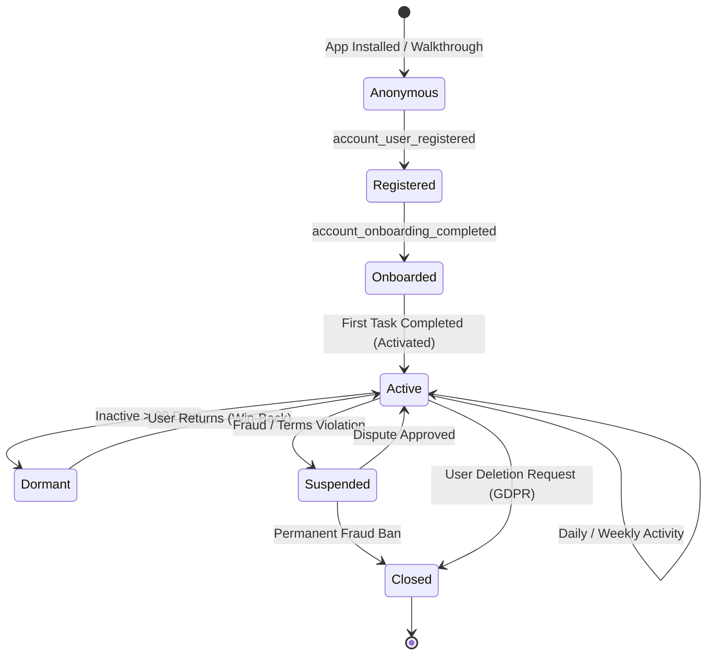

# 04 — WORK PACKAGE B: USER & ACCOUNT ANALYTICS SPECIFICATION

> **MANDATORY DATA AUTHENTICITY NOTICE**  
> *VELOOP is a real product under development, but the data supplied and evaluated for this assignment is fictional/simulated for analytical testing. In accordance with the Data Authenticity Policy, no metric or finding herein represents actual VELOOP production statistics, actual earnings, actual withdrawals, or live business performance.*

---

## 1. Executive Mandate & Architectural Objective
To evaluate product health, acquisition economics, cohort retention, and lifecycle churn, VELOOP must implement a rigorous analytical identity and user state model. This specification defines the foundational data structures governing **User Identity (B1)**, **Account Lifecycle & Progression (B2)**, and **Telemetry Data Schemas** while strictly upholding privacy principles by eliminating unnecessary Personally Identifiable Information (PII).

---

## 2. Work Package B1: User Identity Architecture

A modern event-driven analytics architecture cannot rely on a single primary key. It requires four distinct, non-overlapping identifiers:

```
+---------------------------------------------------------------------------------------------------------+
|                                    FOUR-TIER IDENTITY ARCHITECTURE                                      |
+------------------------------------+-----------------------------------+--------------------------------+
| IDENTIFIER TYPE                    | SYSTEM SCOPE                      | CORE ANALYTICAL PURPOSE        |
+------------------------------------+-----------------------------------+--------------------------------+
| 1. Stable User ID (user_id)        | Global User Profile (Persistent)  | Joins all user events across   |
|                                    |                                   | time, devices, and sessions.   |
| 2. Event ID (event_id)             | Telemetry Stream (Ephemeral)      | Idempotency; prevents duplicate|
|                                    |                                   | processing of client retries.  |
| 3. Session ID (session_id)         | App Runtime Context (Transient)   | Defines user visit boundaries, |
|                                    |                                   | bounce rate, & session length. |
| 4. Transaction ID (transaction_id) | Financial Ledger (Immutable)      | Double-entry journal audit;    |
|                                    |                                   | balance integrity enforcement. |
+------------------------------------+-----------------------------------+--------------------------------+
```

### Detailed Justification for Each Identifier

#### 1. Stable User Identifier (`user_id`)
- **Definition**: An immutable, synthetic surrogate key generated upon initial account creation (e.g., `USR_00001` or an RFC 4122 UUID v4).
- **Why It Is Needed**:
  - Serves as the universal entity key binding all actions across the ecosystem (tasks, rewards, transactions, referrals).
  - Shields the data warehouse from PII changes: email addresses, phone numbers, or social handles can be changed or deleted without breaking longitudinal user history.
  - Prevents tracking leakage when a user switches between mobile and web devices.

#### 2. Event Identifier (`event_id`)
- **Definition**: A globally unique UUID v4 generated on the client device at the exact millisecond a user interaction occurs.
- **Why It Is Needed**:
  - **Idempotency Guarantee**: Mobile networks are unstable. If an HTTP POST request times out, the client SDK retries. Without an `event_id`, the backend would insert two `task_completed` records and credit double points. With `event_id`, an in-memory cache (Redis) discards duplicates.
  - **Deduplication in Data Pipelines**: Enables downstream ingestion pipelines to execute deterministic deduplication (`SELECT DISTINCT ON (event_id)`).

#### 3. Session Identifier (`session_id`)
- **Definition**: A temporary, stateful token generated when the app is foregrounded or the web app is opened, terminated upon 30 minutes of user inactivity or explicit logout.
- **Why It Is Needed**:
  - Without a session boundary, analysts cannot determine whether 10 ad views occurred in a single concentrated 15-minute visit or scattered across 10 distinct days.
  - Enables calculation of vital UX metrics: Average Session Duration, Screens-per-Session, Session Depth, and Task Conversion Rate per visit.

#### 4. Transaction Identifier (`transaction_id`)
- **Definition**: An immutable sequential or UUID key generated by the core double-entry accounting engine for every credit, debit, or escrow reservation.
- **Why It Is Needed**:
  - Segregates financial liability from client telemetry. Telemetry may experience data loss, but financial ledger rows must be guaranteed under strict ACID compliance.
  - Supports self-referencing audit trails: when a withdrawal is reversed or a reward is voided, the new transaction references the original `transaction_id`.

---

## 3. Account Lifecycle & State Transition Model

Every VELOOP user account traverses a defined state machine:



### Lifecycle Stage Criteria
1. **Registration**: User completes authentication credentials. Emits `account_user_registered`.
2. **Onboarding**: User progresses through introductory tutorial. Emits `account_onboarding_completed`.
3. **Activation**: User executes their first validated earning action (ad, survey, tap). Emits `user_activated`.
4. **Retention / Active**: Emits qualifying daily telemetry events within rolling 7-day windows.
5. **Dormancy**: User records zero activity for 30 consecutive calendar days.
6. **Suspension / Ban**: Risk heuristics or KYC failures flag account; balance frozen in escrow.

---

## 4. Work Package B2: User Analytics Specification Table

This table details the exact schema required to capture the full user lifecycle without exposing confidential personal information:

| Field Name | Data Type | Required? | Purpose | Source System | Validation Rule / Regex | Status |
| :--- | :--- | :--- | :--- | :--- | :--- | :--- |
| `user_id` | String | Yes | Permanent unique surrogate user identifier | Auth Service | `^USR_[0-9]{5}$` or UUID v4 | Confirmed |
| `registration_timestamp` | Timestamp | Yes | Cohort grouping, tenure calculation, aging | Auth DB | Valid UTC; `<= CURRENT_TIMESTAMP` | Confirmed |
| `registration_source` | String | Yes | Acquisition channel performance & CAC attribution | Attribution SDK | `IN ('organic', 'referral', 'paid_ad', 'partner_promo', 'influencer')` | Proposed |
| `acquisition_campaign` | String | No | Marketing campaign ROI and ROAS evaluation | Attribution SDK | MaxLength 100, sanitized alphanumeric | Proposed |
| `device_platform` | String | Yes | Cross-platform UX segmentation & telemetry routing | Client OS | `IN ('Android', 'iOS', 'Web')` | Confirmed |
| `device_os_version` | String | Yes | SDK compatibility, bug triage | Client OS | SemVer string (e.g. `14.2.1`) | Proposed |
| `app_version` | String | Yes | Release monitoring, feature rollout cohorting | App Manifest | SemVer string (e.g. `v2.4.1`) | Proposed |
| `country_code` | String | Yes | Geographic segmentation, ad monetization tiers | Geolocation / IP | ISO 3166-1 alpha-2, uppercase | Confirmed |
| `account_status` | String | Yes | Operational lifecycle state of account | User Service | `IN ('active', 'dormant', 'suspended', 'closed')` | Confirmed |
| `is_onboarding_completed` | Boolean | Yes | Onboarding activation funnel milestone | Onboarding SDK | Boolean (`TRUE` / `FALSE`) | Confirmed |
| `onboarding_completed_timestamp`| Timestamp | No | Time-to-activation duration metric | Onboarding SDK | Valid UTC; `>= registration_timestamp` | Proposed |
| `last_login_timestamp` | Timestamp | Yes | Recency scoring, dormancy classification | Auth Manager | Valid UTC; `>= registration_timestamp` | Confirmed |
| `current_streak_count` | Integer | Yes | Daily engagement habit tracking | Streak Service | Non-negative integer (`>= 0`) | Proposed |
| `lifetime_xp` | Integer | Yes | Gamification progression and level tiering | XP Engine | Non-negative integer (`>= 0`) | Proposed |
| `kyc_status` | String | Yes | Withdrawal compliance eligibility gate | Compliance DB | `IN ('none', 'pending', 'verified', 'rejected')` | Proposed |

---

## 5. Data Privacy & Zero-PII Compliance Mandate

To guarantee full compliance with GDPR, CCPA, and Google Play Store policies, the following fields are **strictly prohibited** from the analytics warehouse:

1. **No Passwords or Secret Salts**: Authentication hashes remain exclusively in isolated auth vaults.
2. **No Raw Email or Phone Numbers**: Marketing analytics uses one-way SHA-256 pseudonymized hashes if contact reconciliation is required.
3. **No Unencrypted Payment Credentials**: Bank account numbers, credit card numbers, and PayPal account passwords are never received or logged; only third-party settlement reference hashes (`payout_reference_hash`) are retained.
4. **No Raw Precise Geolocation Coordinates**: Telemetry records country code and city/region, but never latitude/longitude coordinates.

---
*Deliverable Document Reference: `docs/04_USER_ANALYTICS_SPECIFICATION.md` | Schema File: `deliverables_tables/04_USER_ANALYTICS_SPEC.csv`.*
