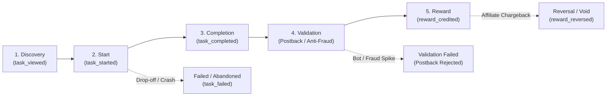
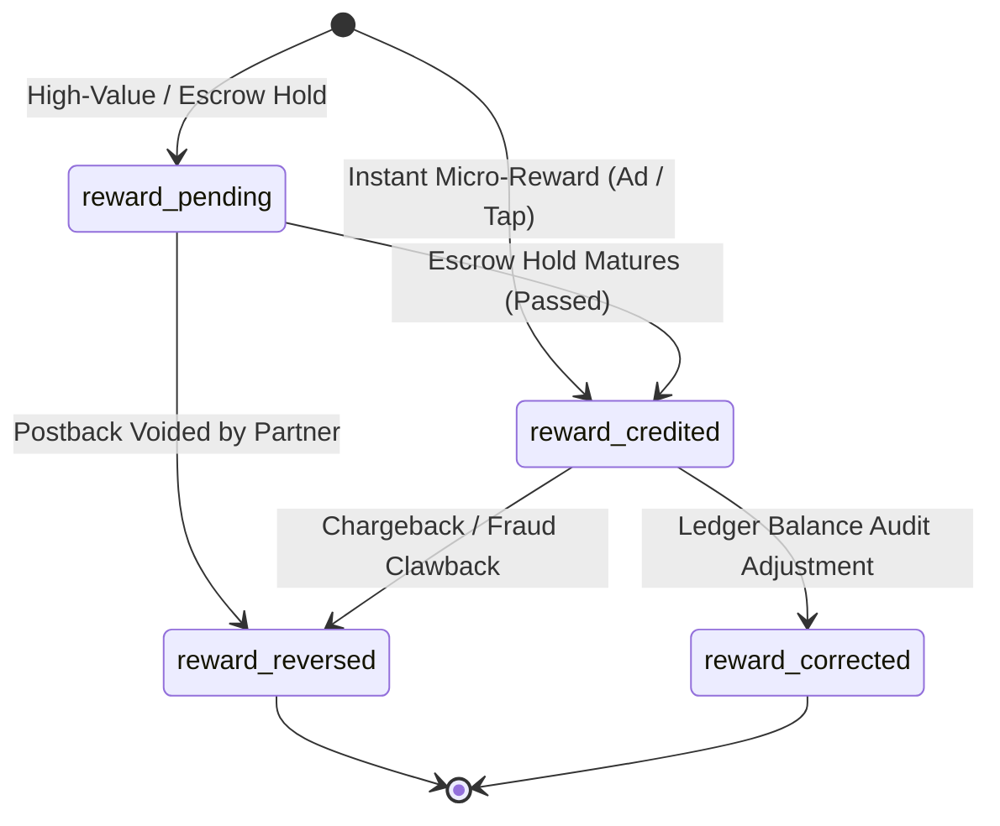

# 05 — WORK PACKAGE C: EARNING & REWARD ANALYTICS SPECIFICATION

> **MANDATORY DATA AUTHENTICITY NOTICE**  
> *VELOOP is a real product under development, but the data supplied and evaluated for this assignment is fictional/simulated for analytical testing. In accordance with the Data Authenticity Policy, no metric or finding herein represents actual VELOOP production statistics, actual earnings, actual withdrawals, or live business performance.*

---

## 1. The Core Analytical Earning Lifecycle
Earning activities form the commercial engine of the VELOOP ecosystem. To measure feature performance, partner yield, and user friction accurately, VELOOP must track every earning opportunity through a five-stage analytical lifecycle:



### Stage Definitions & Transition Criteria
1. **Discovery**: A task card appears in the user's viewport for at least 1.0 second. Emits `task_viewed`. Measures catalog impression density and click-through rate (CTR).
2. **Start**: The user explicitly taps "Start Task" or triggers an ad stream. A unique `task_activity_id` is assigned and an execution timer begins. Emits `task_started`.
3. **Completion**: The client-side task conditions are met (e.g., video reaches 100% playback; survey form is submitted). Emits `task_completed`.
4. **Validation**: An internal heuristic or third-party server-to-server (S2S) postback verifies the legitimacy of the completion. Transition states: `validated`, `rejected`, or `pending`.
5. **Reward**: The rewards engine receives the validation signal and writes an atomic journal entry to the ledger. Emits `reward_credited`.

---

## 2. Work Package C1: Task-Level Analytics Specification

Every task-based activity execution must record the following 12 attributes:

| Field Name | Type | Description | Allowed Values / Format | Analytical Purpose | Status |
| :--- | :--- | :--- | :--- | :--- | :--- |
| `task_activity_id` | String | Unique surrogate execution identifier | `TSK_[0-9]{6}` | Primary Key; links execution to reward | Confirmed |
| `task_id` | String | Catalog identifier for task template | Alphanumeric (e.g. `TK_AD_101`) | Measures performance of specific tasks | Confirmed |
| `task_type` | String | Earning category | `watch_ad`, `survey`, `tap_earn`, `mining`, `offerwall`, `app_install` | Category segmentation and yield analysis | Confirmed |
| `feature_category`| String | High-level module | `Earning`, `Gamification`, `Daily` | Broad product reporting | Confirmed |
| `user_id` | String | Executing user identifier | `USR_[0-9]{5}` | FK to Users; individual earning depth | Confirmed |
| `started_at` | Timestamp | Timestamp when task opened | Valid UTC ISO 8601 | Start volume, hourly traffic distribution | Confirmed |
| `completed_at` | Timestamp | Timestamp when task finished | Valid UTC ISO 8601 (`>= started_at`)| Duration calculation; abandonment timing | Confirmed |
| `status` | String | Terminal operational status | `completed`, `failed`, `abandoned`, `pending_validation` | Funnel drop-off and completion rate | Confirmed |
| `reward_amount` | Numeric | Potential reward magnitude | Numeric (`> 0`) | Estimated liability creation | Confirmed |
| `reward_unit` | String | Denomination of reward | `VEs`, `Gems`, `XP` | Unit-specific ledger aggregation | Confirmed |
| `validation_status`| String | Fraud and postback audit state | `validated`, `rejected`, `pending` | Anti-fraud pass rate, partner reliability | Confirmed |
| `partner_provider`| String | Third-party ad/offer network | `GoogleAdMob`, `Pollfish`, `Tapjoy`, `InternalEngine` | Partner vendor yield and uptime comparison | Confirmed |

---

## 3. Work Package C2: Failed Activity Taxonomy (Proposed)

Failed activities must not be discarded. They represent critical signals of user frustration, technical bugs, or malicious behavior. VELOOP implements a **Proposed 5-Tier Failure Classification Model**:

```
+---------------------------------------------------------------------------------------------------------+
|                                  PROPOSED FAILED ACTIVITY CLASSIFICATION                                |
+-----------------------+--------------------+------------------------------------------------------------+
| FAILURE CATEGORY      | SEVERITY LEVEL     | TECHNICAL DEFINITION & ROOT CAUSE                          |
+-----------------------+--------------------+------------------------------------------------------------+
| 1. task_failed        | Medium             | User failed in-game objective, survey screening gate, or   |
|                       |                    | failed to meet required eligibility criteria.              |
| 2. tracking_failed    | Critical           | Third-party SDK dropped postback, network timeout severed  |
|                       |                    | callback, or deep-link redirect failed to fire.            |
| 3. validation_failed  | High               | Anti-fraud heuristics triggered: emulator detected, VPN    |
|                       |                    | mismatch, automated macro-clicking, or multi-account loop. |
| 4. user_abandoned     | Low                | User closed modal, pressed back button, or force-quit the  |
|                       |                    | app prior to reaching completion threshold.                |
| 5. system_error       | Critical           | Internal server 5xx crash, database timeout, or partner ad |
|                       |                    | stream exhaustion (HTTP 204 No Ad Content).                |
+-----------------------+--------------------+------------------------------------------------------------+
```

### Telemetry Implementation for Failures
When a failure occurs, the client SDK or backend gateway emits `task_failed` with the following mandatory payload:
```json
{
  "event_id": "8f3b21e8-7a54-4c02-9981-d1c97a661f03",
  "event_name": "task_failed",
  "user_id": "USR_00142",
  "task_activity_id": "TSK_005821",
  "task_id": "TK_SURV_201",
  "failure_category": "tracking_failed",
  "error_reason_code": "ERR_PARTNER_TIMEOUT_HTTP_504",
  "elapsed_duration_seconds": 45,
  "partner_provider": "Pollfish",
  "timestamp": "2026-06-14T11:22:15Z"
}
```

---

## 4. Work Package C3: Reward Events — Decoupling Activity from Crediting

> [!IMPORTANT]
> **Analytical Law of Reward Systems**:  
> *The occurrence of an activity is a behavioral event; the crediting of a reward is a financial transaction. They must NEVER be treated as a single unified record.*

### Why Decoupling is Essential
1. **Asynchronous Settlement**: Ad networks and offerwalls operate on server postbacks that may arrive 30 seconds to 72 hours after task completion.
2. **Escrow Holds for High-Value Offers**: Large app install tasks (e.g., 2,500 VEs) must be placed in a provisional holding escrow (`reward_pending`) to protect against user uninstallation after cash-out.
3. **Clawbacks & Reversals**: If an affiliate network detects fraud, they reverse the commission. VELOOP must record a `reward_reversed` event referencing the original transaction without deleting historical records.

### Four Core Reward Events



1. `reward_credited`: Points permanently committed to user balance. Emits ledger posting reference.
2. `reward_pending`: Points earmarked for user but locked in escrow until verification criteria mature.
3. `reward_reversed`: Points debited back from user balance due to partner rejection or chargeback.
4. `reward_corrected`: Points adjusted via administrative ledger balance reconciliation.

---

## 5. Work Package C4: Third-Party Dependencies & Data Reality

Unlike self-contained consumer software, an online rewards ecosystem relies heavily on external ad networks (AdMob, IronSource), survey routers (Pollfish, TheoremReach), offerwalls (Tapjoy, adjoe), and payment gateways (PayPal, Crypto rails). 

```
+---------------------------------------------------------------------------------------------------------+
|                                    THIRD-PARTY DEPENDENCY VULNERABILITIES                               |
+--------------------+--------------------------------+---------------------------------------------------+
| EXTERNAL COMPONENT | EXTERNAL DEPENDENCY RISK       | ANALYTICAL DESIGN DEFENSE                         |
+--------------------+--------------------------------+---------------------------------------------------+
| Video Ad Networks  | Inventory exhaustion (No Fill);| Track ad request vs impression; isolate partner   |
|                    | client-side SDK stream crashes.| SDK timeouts from internal UI bugs.               |
| Survey Routers     | High screening rejection rates | Segregate demographic screening dropouts from     |
|                    | after 10 minutes of questions. | genuine task abandonment.                         |
| Game Offerwalls    | Delayed multi-stage postbacks  | Use external transaction IDs (postback hashes) to |
|                    | spanning days or weeks.        | join multi-day events.                            |
| Tracking SDKs      | Deep-link attribution loss on  | Maintain fallback manual attribution codes and    |
|                    | iOS App Tracking Transparency. | aggregate probabilistic cohort models.            |
+--------------------+--------------------------------+---------------------------------------------------+
```

### Engineering Guidelines for External Dependencies
1. **Never Assume Synchronous Responses**: Always store raw partner callback payloads in an append-only webhook archive before processing.
2. **Enforce Postback Signature Verification**: Check HMAC-SHA256 signatures on incoming partner webhooks to prevent spoofed completions.
3. **Log Partner Discrepancies**: Maintain daily reconciliation tables comparing VELOOP task completions against partner invoice statements.

---
*Deliverable Document Reference: `docs/05_EARNING_REWARD_ANALYTICS.md` | Related Spec: `deliverables_tables/08_EVENT_TRACKING_PLAN.csv`.*
