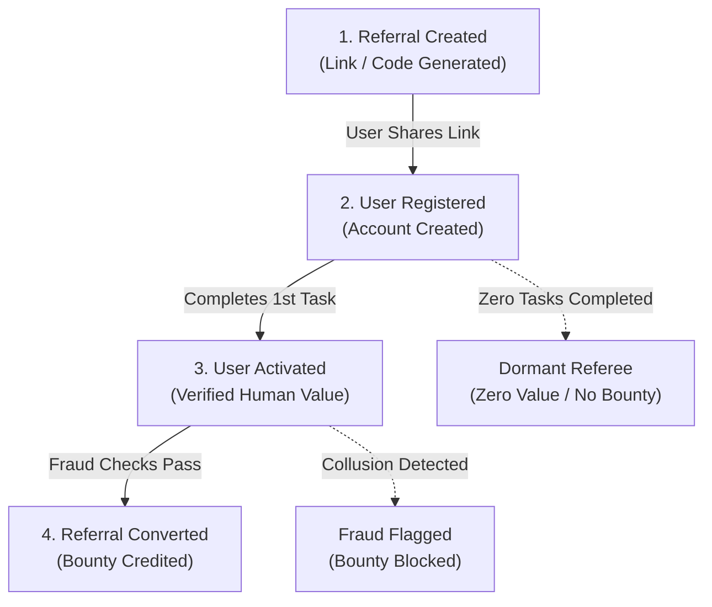

# 07 — WORK PACKAGE E: REFERRAL & ENGAGEMENT ANALYTICS SPECIFICATION

> **MANDATORY DATA AUTHENTICITY NOTICE**  
> *VELOOP is a real product under development, but the data supplied and evaluated for this assignment is fictional/simulated for analytical testing. In accordance with the Data Authenticity Policy, no metric or finding herein represents actual VELOOP production statistics, actual earnings, actual withdrawals, or live business performance.*

---

## 1. Executive Context & Viral Economics
Referral marketing and user engagement loops represent the core growth engine of VELOOP. However, conventional analytics systems frequently commit the fatal error of **equating app installation or signup with referral success**. In an incentivized rewards platform, this naive assumption enables bot farms and bad actors to bleed platform marketing budgets through hollow registrations.

This specification details the **Four-Stage Referral Measurement Model (E1)** and the **Comprehensive User Engagement Framework (E2)**.

---

## 2. Work Package E1: The Four-Stage Referral Funnel

To safeguard platform economics and measure genuine viral compounding, VELOOP enforces a four-stage referral lifecycle:



### Stage Definitions & Gatekeeping Rules
1. **Referral Created**: An existing active user generates an invite link or shares a referral code via social channels (WhatsApp, Telegram, Twitter). Emits `referral_link_generated`.
2. **User Registered**: A new referee installs the app and completes account creation with the referral token bound. Emits `referral_referee_registered`.  
   *CRITICAL POLICY*: **Zero bounty is paid at this stage**. The referee has generated zero platform revenue.
3. **User Activated**: The referee successfully completes their **first validated earning task** (e.g., watches a rewarded video ad or completes a verified survey). Emits `referral_referee_activated`. This proves human intent and delivers commercial value.
4. **Referral Converted**: The system runs anti-collusion heuristics (verifying the referee does not share device fingerprint, IP subnet, or payment details with the referrer). Upon passing, the referral bounty is posted to the referrer's wallet. Emits `referral_bonus_converted`.

### Referral Schema Specification

| Field Name | Type | Format / Constraints | Analytical Purpose | Status |
| :--- | :--- | :--- | :--- | :--- |
| `referral_id` | String | `REF_[0-9]{4}` | Primary Key; tracks referral lifecycle record | Confirmed |
| `referring_user_id`| String | `USR_[0-9]{5}` | FK to Users; identifies referring advocate | Confirmed |
| `referred_user_id` | String | `USR_[0-9]{5}` or `NULL` | FK to Users; identifies acquired referee | Confirmed |
| `invite_channel` | String | `WhatsApp`, `Telegram`, `Twitter`, `DirectLink`, `SMS` | Channel viral conversion efficiency | Confirmed |
| `creation_timestamp`| Timestamp | Valid UTC ISO 8601 | Measures share volume and intent | Confirmed |
| `registration_timestamp`| Timestamp| Valid UTC ISO 8601 (`>= creation_timestamp`) | Share-to-signup latency | Confirmed |
| `activation_timestamp`| Timestamp| Valid UTC ISO 8601 (`>= registration_timestamp`)| Time-to-activation velocity | Confirmed |
| `status` | String | `link_created`, `registered`, `activated`, `converted` | Funnel drop-off and leak identification | Confirmed |
| `reward_credited_to_referrer`| Boolean | `TRUE` / `FALSE` | Financial referral liability accounting | Confirmed |
| `attribution_source`| String | `campaign_share_sheet`, `web_landing_cookie`, `manual_code` | Technical attribution rail audit | Proposed |

---

## 3. Work Package E2: Comprehensive Engagement Framework

User engagement cannot be summarized by a simple "login" counter. VELOOP's engagement model measures six dimensions of platform interaction:

```
+---------------------------------------------------------------------------------------------------------+
|                                    SIX-DIMENSION ENGAGEMENT TAXONOMY                                    |
+------------------------------------+-----------------------------------+--------------------------------+
| ENGAGEMENT DIMENSION               | TECHNICAL DEFINITION              | METRIC / OPERATIONAL INDICATOR |
+------------------------------------+-----------------------------------+--------------------------------+
| 1. Feature Adoption                | Breadth of catalog exploration    | % DAU utilizing >= 3 features  |
| 2. Repeat Usage & Habits           | Frequency of habit re-entry       | 7-Day Streak Continuity Rate   |
| 3. Task Activity Depth             | Density of earning execution      | Tasks Completed per Active User|
| 4. Temporal Daily Activity         | Diurnal session distribution      | Peak Hour Traffic & DAU/WAU    |
| 5. Feature Interaction Frequency   | Granular module hit rate          | Spins/Check-ins per user/day   |
| 6. User Retention & Return         | Cohort longevity & win-back       | D1, D7, D30 Rolling Retention  |
+------------------------------------+-----------------------------------+--------------------------------+
```

### Detailed Engagement Metrics

#### A. Active User Hierarchy
- **Daily Active Users (DAU)**: Unique individual users who generate at least one interactive telemetry event (`qualifying_event = TRUE`) within a UTC calendar day. Excludes passive background syncs.
- **Weekly Active Users (WAU)**: Unique users active within a rolling 7-day window.
- **Monthly Active Users (MAU)**: Unique users active within a rolling 30-day window.
- **Stickiness Ratio**: `(DAU / MAU) * 100`. Indicates the percentage of monthly users who return daily.

#### B. Returning vs New User Segmentation
To isolate growth dynamics, daily traffic is decomposed into four mutually exclusive user cohorts:
```
Total Daily Users = New Registrants + Resurrected Users + Retained Current Users
```
1. **New Users**: Registered on the current calendar day.
2. **Retained Users**: Active today AND active in the preceding 7 days.
3. **Resurrected / Win-Back Users**: Active today, but inactive for the preceding 14 to 30 days.
4. **Dormant / Lapsed Users**: Zero activity in the past 30 days.

#### C. Feature Frequency & Adoption Density
Tracks which product modules serve as primary daily gateways versus secondary exploration:
- **Primary Gateway**: Daily Check-in & Watch Ads (>70% DAU adoption).
- **Secondary Loop**: Lucky Spin & Tap-and-Earn (40–60% DAU adoption).
- **High-Intent Destination**: Surveys, Offerwalls, and Withdrawals (15–30% DAU adoption).

---

## 4. Viral Growth Modeling: The K-Factor (Viral Coefficient)

To evaluate whether VELOOP can achieve self-sustaining organic growth, analytics tracks the **Viral Coefficient ($K$)**:

$$K = i \times c$$

Where:
- $i$ = **Average Invites Sent per Active User**: $\frac{\text{Total Referral Links Generated}}{\text{Total Active Users}}$
- $c$ = **Conversion Rate to Activated Referee**: $\frac{\text{Total Activated Referees}}{\text{Total Referral Links Generated}}$

### Strategic Interpretation of $K$:
- **$K > 1.0$**: Exponential viral growth. Every user brings more than one active user into the system without paid ad spend.
- **$K = 1.0$**: Stable self-sustaining growth.
- **$K < 1.0$**: Viral decay. The platform requires paid marketing campaigns to replenish user acquisition.

---
*Deliverable Document Reference: `docs/07_REFERRAL_ENGAGEMENT_ANALYTICS.md` | Related Spec: `deliverables_tables/11_KPI_CATALOGUE.csv`.*
