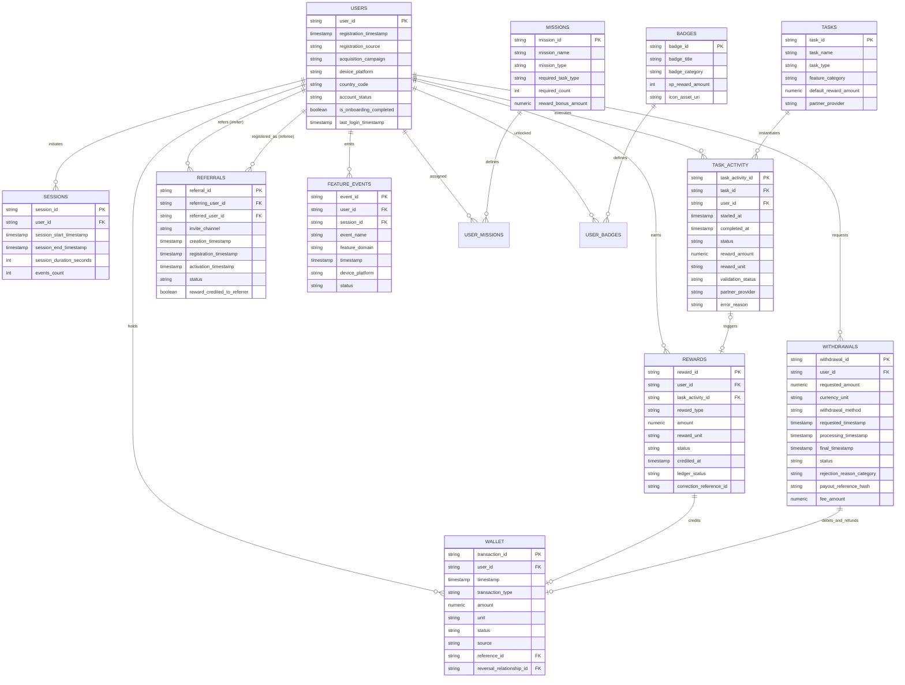

# 10 — WORK PACKAGE H: LOGICAL DATA MODEL & ER DIAGRAM

> **MANDATORY DATA AUTHENTICITY NOTICE**  
> *VELOOP is a real product under development, but the data supplied and evaluated for this assignment is fictional/simulated for analytical testing. In accordance with the Data Authenticity Policy, no metric or finding herein represents actual VELOOP production statistics, actual earnings, actual withdrawals, or live business performance.*

---

## 1. Executive Modeling Architecture
The **VELOOP Logical Data Model (Work Package H)** designs the relational and dimensional structure uniting all product, telemetry, and transactional systems. The architecture implements a **Medallion Snowflake / Star Schema** hybrid: relational third-normal-form (3NF) core entities for ACID financial transactions, surrounded by dimensional star-schema activity tables optimized for high-throughput OLAP analytics.

---

## 2. Professional Entity-Relationship (ER) Diagram



---

## 3. Work Package H1: Primary Key Architecture

Every entity in the VELOOP data model utilizes a deterministic, surrogate primary key to guarantee uniqueness and eliminate composite join overhead:

| Entity Name | Primary Key Column | Key Type | Format / Constraints | Generation Origin |
| :--- | :--- | :--- | :--- | :--- |
| **Users** | `user_id` | String | `^USR_[0-9]{5}$` or UUID v4 | Auth Microservice |
| **Sessions** | `session_id` | String | `^SES_[0-9]{6}$` | Client Mobile / Web SDK |
| **Tasks** | `task_id` | String | `^TK_[A-Z]+_[0-9]+$` | Catalog CMS / Backoffice |
| **Task_Activity**| `task_activity_id` | String | `^TSK_[0-9]{6}$` | Task Execution Engine |
| **Rewards** | `reward_id` | String | `^RWD_[0-9]{5}$` | Rewards Engine |
| **Wallet** | `transaction_id` | String | `^TXN_[0-9]{6}$` | Double-Entry Core Ledger |
| **Withdrawals** | `withdrawal_id` | String | `^WDR_[0-9]{4}$` | Withdrawal Subsystem |
| **Referrals** | `referral_id` | String | `^REF_[0-9]{4}$` | Referral Attribution Service |
| **Feature_Events**| `event_id` | String | UUID v4 / `^EVT_[0-9]{6}$` | Telemetry SDK |
| **Missions** | `mission_id` | String | `^MSN_[0-9]{3}$` | Gamification Engine |
| **Badges** | `badge_id` | String | `^BDG_[A-Z_0-9]+$` | Achievement Service |

---

## 4. Work Package H2: Foreign Keys & Relational Cardinality

The foreign key architecture maintains strict referential integrity across transactional and analytical workloads:

```
+---------------------------------------------------------------------------------------------------------+
|                                      FOREIGN KEY RELATIONSHIP MAP                                       |
+----------------------+--------------------+--------------------+--------------------+-------------------+
| CHILD TABLE          | FOREIGN KEY (FK)   | PARENT TABLE       | PRIMARY KEY (PK)   | CARDINALITY       |
+----------------------+--------------------+--------------------+--------------------+-------------------+
| Sessions             | user_id            | Users              | user_id            | Many-to-One (N:1) |
| Task_Activity        | user_id            | Users              | user_id            | Many-to-One (N:1) |
| Task_Activity        | task_id            | Tasks              | task_id            | Many-to-One (N:1) |
| Rewards              | user_id            | Users              | user_id            | Many-to-One (N:1) |
| Rewards              | task_activity_id   | Task_Activity      | task_activity_id   | One-to-One (1:1)  |
| Wallet               | user_id            | Users              | user_id            | Many-to-One (N:1) |
| Wallet               | reference_id       | Rewards            | reward_id          | Many-to-One (N:1) |
| Wallet               | reference_id       | Withdrawals        | withdrawal_id      | Many-to-One (N:1) |
| Withdrawals          | user_id            | Users              | user_id            | Many-to-One (N:1) |
| Referrals            | referring_user_id  | Users              | user_id            | Many-to-One (N:1) |
| Referrals            | referred_user_id   | Users              | user_id            | Zero-or-One (0:1) |
| Feature_Events       | user_id            | Users              | user_id            | Many-to-One (N:1) |
| Feature_Events       | session_id         | Sessions           | session_id         | Many-to-One (N:1) |
+----------------------+--------------------+--------------------+--------------------+-------------------+
```

---

## 5. Work Package H3: Relationship Taxonomy & Behavioral Documentation

### 1. One-to-Many Relationships (1:N)
- `Users` to `Task_Activity`: A single registered user executes zero, one, or thousands of task attempts over their platform lifetime.
- `Users` to `Withdrawals`: An active user submits multiple withdrawal requests across weeks or months.
- `Tasks` to `Task_Activity`: A single task catalog entry (e.g. AdMob video card) is instantiated repeatedly across different user sessions.

### 2. One-to-One Relationships (1:1 / Conditional)
- `Task_Activity` to `Rewards`: For task-based rewards, exactly one validated task execution (`task_activity_id`) maps to exactly one reward credit (`reward_id`).  
  *Exception*: Daily login rewards and streak bonuses do not have an upstream `task_activity_id` and leave this foreign key NULL.

### 3. Self-Referencing Audit Relationships (1:1 Offset)
- `Rewards.correction_reference_id` $\rightarrow$ `Rewards.reward_id`: When a reward is reversed due to affiliate chargebacks, the reversal record contains a self-referencing foreign key pointing to the original credited row.
- `Wallet.reversal_relationship_id` $\rightarrow$ `Wallet.transaction_id`: An administrative or refund ledger journal line references the original debited transaction.

### 4. Dual-Foreign Key Relationships (Referral Graph)
- `Referrals` contains two distinct foreign keys pointing to `Users.user_id`:
  1. `referring_user_id`: Mandatory FK identifying the advocating user who created the invite link.
  2. `referred_user_id`: Optional / nullable FK that is bound when the referee completes registration.  
  *Integrity Constraint*: `CHECK (referring_user_id <> referred_user_id)` to prevent self-referral exploitation.

---

## 6. Analytical Dimensional Modeling (Kimball Star Schema)
For high-performance executive dashboard querying in the Gold Layer, these relational entities are transformed via dbt into dimensional fact and dimension tables:

```
                  +---------------------------+
                  |      dim_users (SCD-2)    |
                  +-------------+-------------+
                                |
                                | user_id
                                v
+-------------------+     +-----+--------------------+     +-------------------+
|  dim_date (Time)  |---->|   fct_user_activity_daily  |<----|    dim_devices    |
+-------------------+     +-----+--------------------+     +-------------------+
                                ^
                                |
                  +-------------+-------------+
                  |    dim_product_features   |
                  +---------------------------+
```

1. **`fct_user_activity_daily`**: Pre-aggregated daily grain fact table tracking DAU, tasks completed, rewards earned, cash-outs requested, and active time per user.
2. **`fct_ledger_transactions`**: Atomic financial transaction fact table recording all double-entry ledger entries.
3. **`fct_withdrawal_pipeline`**: Payout lifecycle tracking table monitoring SLA durations, rejection categories, and settlement hashes.

---
*Deliverable Document Reference: `docs/10_LOGICAL_DATA_MODEL.md` | Schema Tables: `deliverables_tables/`.*
