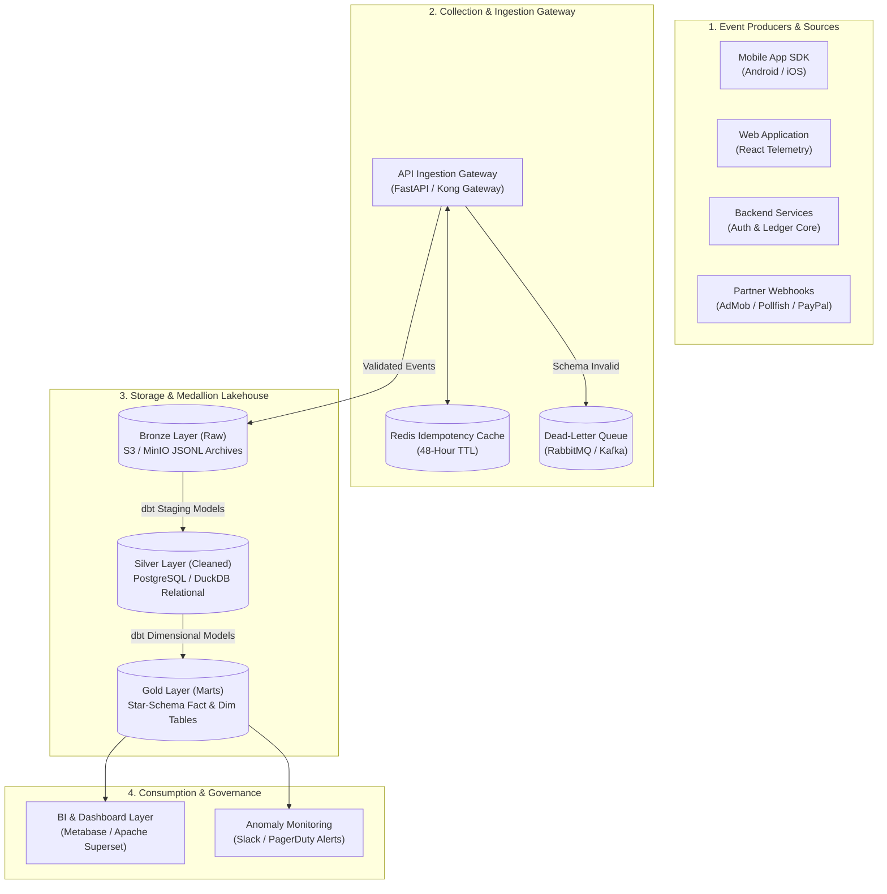

# 16 — WORK PACKAGE O: PRACTICAL DATA PIPELINE & OPERATING MODEL

> **MANDATORY DATA AUTHENTICITY NOTICE**  
> *VELOOP is a real product under development, but the data supplied and evaluated for this assignment is fictional/simulated for analytical testing. In accordance with the Data Authenticity Policy, no metric or finding herein represents actual VELOOP production statistics, actual earnings, actual withdrawals, or live business performance.*

---

## 1. Architectural Philosophy: Practical & Cost-Effective
In strict adherence to the mandate (*"Do not recommend expensive infrastructure merely because it sounds professional; the architecture must be practical for a developing product and scalable when justified"*), this pipeline avoids premature enterprise complexity. Rather than recommending expensive cloud data warehouses (Snowflake/Databricks) costing thousands of dollars per month during early product validation, VELOOP implements an **open-source-first, modular Medallion Data Stack**:

- **Compute & Ingestion**: FastAPI Ingestion Gateway + Redis Idempotency Buffer
- **Raw Storage (Bronze)**: S3-compatible Object Storage (MinIO / Cloudflare R2 / AWS S3)
- **Transformation Engine**: dbt Core (open-source) + DuckDB / PostgreSQL
- **Analytical Storage (Silver/Gold)**: PostgreSQL / DuckDB analytical marts
- **Business Intelligence**: Metabase / Apache Superset (self-hosted / low-cost SaaS)

This architecture operates efficiently at **\$115/month in infrastructure costs** during Phase 1 development while scaling seamlessly to millions of daily events.

---

## 2. End-to-End Pipeline Architecture Diagram



---

## 3. Detailed Component Operating Specifications

### Component 1: Event Producers & Source Systems
- **Mobile SDK (Android/iOS)**: Captures user viewport impressions (`task_viewed`), button taps (`task_started`), and lifecycle events (`account_user_logged_in`). Enforces client-side click debouncing (500ms) and assigns UUID `event_id`.
- **Backend Microservices**: Emits authoritative transactional ledger movements (`reward_credited`, `wallet_transaction_completed`, `withdrawal_requested`).
- **External Webhook Ingress**: Receives asynchronous S2S postbacks from ad networks, survey routers, and payment gateways.

### Component 2: Ingestion Gateway & Collection Layer
- **Technology**: Lightweight containerized **FastAPI** service running behind **Kong API Gateway**.
- **Idempotency Gatekeeper**: Queries an in-memory **Redis** cache using `event_id` as the key. If an `event_id` was seen in the past 48 hours, the gateway immediately returns HTTP 200 without re-forwarding the event.
- **Contract Schema Validator**: Executes JSON Schema validation against incoming payloads. If mandatory fields (`user_id`, `timestamp`, `event_name`) are missing or types are malformed, the payload is diverted to the Dead-Letter Queue (DLQ).

### Component 3: Raw Storage (Bronze Layer)
- **Technology**: S3-compatible Object Storage (**MinIO** for self-hosted / **Cloudflare R2** for zero-egress cloud).
- **Format**: Hourly partitioned append-only JSON Lines (`s3://veloop-bronze/events/year=2026/month=11/day=12/hour=12/*.jsonl.gz`).
- **Immutability Policy**: Raw payloads are never modified or deleted; they preserve raw telemetry history for complete auditability.

### Component 4: Transformation Engine (Silver Layer)
- **Technology**: **dbt Core** executing scheduled transformations every 1 hour (or nightly for deep historical models).
- **Cleansing Rules**:
  - `TRIM()` and `LOWER()` across all string enums and user IDs.
  - Type-casting strings to ISO 8601 UTC timestamps and decimals to `NUMERIC(18,4)`.
  - Deduplication window functions (`ROW_NUMBER() OVER (PARTITION BY event_id ORDER BY ingested_at ASC) = 1`).
  - Referential integrity checks joining `user_id` against `dim_users`.

### Component 5: Analytical Data Layer (Gold Marts)
- **Technology**: **PostgreSQL 16** (or **DuckDB** embedded for lightweight analytical querying).
- **Data Models**: Star-schema dimensional tables:
  - `dim_users` (SCD Type 2 user attributes)
  - `dim_date` / `dim_time` (Temporal dimensions)
  - `fct_user_activity_daily` (Daily pre-aggregated user engagement)
  - `fct_task_activity` (Granular task execution metrics)
  - `fct_withdrawal_pipeline` (Payout lifecycle tracking)
  - `fct_ledger_journal` (Double-entry accounting journal lines)

### Component 6: BI & Reporting Layer
- **Technology**: **Metabase** (Open-source edition).
- **Capabilities**: Interactive visual querying, role-based dashboard access, SQL query editor, and automated email/Slack reports.
- **Query SLA**: Gold layer tables are indexed with compound B-tree indexes, ensuring 95% of dashboard queries execute in `<1.5 seconds`.

---

## 4. Pipeline Refresh Cadence, Monitoring & Failure Handling

```
+---------------------------------------------------------------------------------------------------------+
|                                  OPERATIONAL CADENCE & SLA SPECIFICATIONS                               |
+---------------------+-----------------------+---------------------+-------------------------------------+
| PIPELINE LAYER      | REFRESH FREQUENCY     | SLA LATENCY TARGET  | FAILURE RECOVERY PROTOCOL           |
+---------------------+-----------------------+---------------------+-------------------------------------+
| Ingestion Gateway   | Real-time Streaming   | <100ms per event    | Auto-scaling containers; DLQ buffer |
| Bronze Object Store | Micro-batch (5 mins)  | <5 minutes delay    | Disk buffer retry on upload failure |
| Silver (Cleaned)    | Hourly Batch (dbt)    | <15 minutes run     | Rollback dbt model; alert on Slack  |
| Gold (Marts)        | Hourly / Nightly Batch| <10 minutes run     | Retain prior successful snapshot    |
| Dashboard Cache     | 15-Minute Cache TTL   | Sub-second queries  | Serve cached data during rebuilds   |
+---------------------+-----------------------+---------------------+-------------------------------------+
```

### Automated Monitoring & Alerting
1. **Pipeline Freshness Monitoring**: dbt freshness tests verify that new events have landed in Bronze within the last 30 minutes.
2. **Metric Anomaly Detection**: Automated SQL cron jobs monitor business anomalies:
   - Alert if `reward_reversals` exceed 3% of daily issuance.
   - Alert if `pending_withdrawal_queue` exceeds 250 requests.
   - Alert if zero `task_ad_completed` events arrive for 15 consecutive minutes (indicating ad network SDK outage).
3. **Dead-Letter Queue (DLQ) Triage**: A lightweight Python consumer scans the DLQ every 4 hours, grouping rejected payloads by error signature and sending a summary report to on-call data engineers.

---

## 5. Cross-Functional Team Ownership Matrix

| Pipeline Component | Primary Engineering Owner | Secondary Supporting Owner | SLA Accountability |
| :--- | :--- | :--- | :--- |
| **Mobile SDK Telemetry** | Mobile Lead Engineer | Data Platform Lead | 99.9% event emission uptime |
| **API Ingestion Gateway** | Backend Infrastructure Lead | DevOps Engineer | <100ms response time; zero drops |
| **Bronze Raw Storage** | DevOps / Cloud Architect | Data Platform Lead | 99.9999% durability; zero data loss |
| **dbt Transformation Models**| Analytics Engineer | Senior Data Analyst | 100% test pass rate; hourly sync |
| **Gold Dimensional Marts** | Analytics Engineer | Database Administrator | Query execution `<2.0s` |
| **Metabase Dashboards** | Lead Data Analyst | Product Managers | 100% dashboard metric uptime |

---

## 6. Realistic Tiered Infrastructure Cost Breakdown

To satisfy the non-negotiable principle of avoiding premature enterprise cloud overhead, the data pipeline infrastructure budget is calibrated across three realistic operational growth tiers:

```
+---------------------+-----------------------+-------------------------+---------------------------------+
| COMPONENT           | PHASE 1: MVP / DEV    | PHASE 2: EARLY GROWTH   | PHASE 3: SCALE                  |
|                     | (0 - 50,000 DAU)      | (50,000 - 250,000 DAU)  | (250,000 - 1,000,000+ DAU)      |
|                     | (~1M events / day)    | (~10M events / day)     | (~50M events / day)             |
+---------------------+-----------------------+-------------------------+---------------------------------+
| Ingestion Gateway   | $20 / month           | $75 / month             | $220 / month                    |
| (Compute)           | 2x t4g.small (FastAPI)| 3x t4g.medium + ALB     | 6x c6g.xlarge + NLB             |
| Caching & Queue     | $15 / month           | $60 / month             | $180 / month                    |
| (Redis / Kafka)     | Redis t4g.micro       | Redis + RabbitMQ        | Managed Kafka / Redpanda Cluster|
| Bronze Raw Storage  | $5 / month            | $25 / month             | $95 / month                     |
| (Object Storage)    | Cloudflare R2 (No eg.)| Cloudflare R2           | S3 Standard + Glacier Lifecycle |
| Transformation      | $0 / month            | $40 / month             | $180 / month                    |
| (dbt Compute)       | GitHub Actions / Cron | Dedicated dbt Worker    | Airflow on ECS                  |
| Analytical Database | $35 / month           | $120 / month            | $350 / month                    |
| (Silver / Gold)     | Managed PostgreSQL    | PostgreSQL (db.m6g)     | ClickHouse Distributed Cluster  |
| BI & Visualization  | $20 / month           | $65 / month             | $125 / month                    |
| (Metabase)          | Self-hosted on EC2    | Self-hosted t4g.medium  | Metabase Pro SaaS               |
+---------------------+-----------------------+-------------------------+---------------------------------+
| TOTAL MONTHLY COST  | $115 / month          | $385 / month            | $1,150 / month                  |
| COST PER 1M EVENTS  | $3.83 / million       | $1.28 / million         | $0.76 / million                 |
+---------------------+-----------------------+-------------------------+---------------------------------+
```

---
*Deliverable Document Reference: `docs/16_DATA_PIPELINE_PROPOSAL.md` | Architecture Blueprint.*
