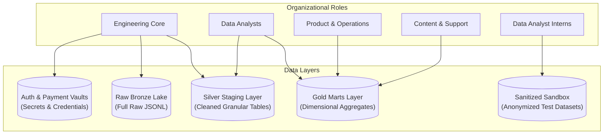

# 17 — WORK PACKAGE P: DATA ACCESS, PRIVACY & GOVERNANCE PROPOSAL

> **MANDATORY DATA AUTHENTICITY NOTICE**  
> *VELOOP is a real product under development, but the data supplied and evaluated for this assignment is fictional/simulated for analytical testing. In accordance with the Data Authenticity Policy, no metric or finding herein represents actual VELOOP production statistics, actual earnings, actual withdrawals, or live business performance.*

---

## 1. Executive Privacy Mandate & Principles
In a rewards ecosystem that processes micro-earnings and real cash redemptions, data governance and user privacy are foundational. VELOOP must maintain strict data compliance (aligned with GDPR, CCPA, and App Store guidelines) while empowering product and analytics teams to innovate.

### Core Governance Principles
1. **Principle of Least Privilege (PoLP)**: Team members are granted access strictly to the data tiers required to perform their explicit job functions.
2. **Zero-PII Analytics Warehouse**: The analytical data warehouse contains zero unencrypted personal information, zero raw payment account credentials, and zero authentication secrets.
3. **Data Sanitization & Tokenization**: All identifiers across the analytical layer are pseudonymized surrogate keys (`user_id`, `event_id`, `transaction_id`).

---

## 2. Role-Based Access Control (RBAC) Operating Model

VELOOP defines 5 distinct organizational access tiers:



### Access Tier Matrix

| Role | Access Tier Description | Accessible Tables & Systems | Prohibited Data & Boundaries |
| :--- | :--- | :--- | :--- |
| **Engineering Core** | Technical Implementation & Infrastructure | Full read/write to API gateway, Kafka brokers, and database schemas; technical event logs. | Prohibited from viewing unmasked production user payment destinations without security audit ticket. |
| **Data Analysts** | Approved Analytical Datasets (Silver/Gold) | Full SQL query access to Silver conformed tables and Gold dimensional marts; raw Bronze logs. | Strict column masking applied on IP addresses and payment transaction hashes. |
| **Product / Operations**| Aggregated Business Intelligence | Read-only Metabase dashboards, executive reporting summaries, pre-built operational query cards. | Zero access to raw terminal tables or individual user activity event streams. |
| **Content & Support** | Aggregated Content & Inquiry Metrics | FAQ article impression views, support ticket issue category distributions, task rating cards. | Zero access to financial ledger transactions or user wallet balances. |
| **Interns / Academic** | Approved & Sanitized Test Datasets | Dedicated sanitized sandbox (`SIMULATED DATA — CREATED FOR ANALYTICAL TESTING`); synthetic datasets. | **Zero access to live production databases**, real user IDs, or actual payment rails. |

---

## 3. Critical Data Exclusion & Prohibited Information Register

To protect user safety and prevent catastrophic security breaches, the following six classes of sensitive information are **strictly barred from entering the analytics warehouse**:

```
+---------------------------------------------------------------------------------------------------------+
|                                    PROHIBITED INFORMATION REGISTER                                      |
+--------------------------+-----------------------+------------------------------------------------------+
| DATA CATEGORY            | CONCRETE EXAMPLES     | MANDATORY GOVERNANCE RESTRICTION                     |
+--------------------------+-----------------------+------------------------------------------------------+
| 1. Passwords & Salts     | Plaintext passwords,  | NEVER ingested into telemetry. Stored exclusively in |
|                          | bcrypt/Argon2 hashes. | isolated auth identity vaults.                       |
| 2. Auth Tokens & Secrets | JWT refresh tokens,   | Filtered out at API gateway. Prohibited from logging |
|                          | session bearer keys.  | in telemetry properties or event headers.            |
| 3. API Keys & Webhooks   | Stripe secret keys,   | Stored in encrypted Secret Managers (AWS Secrets/    |
|                          | AdMob HMAC secrets.   | Vault); never visible in code or database tables.    |
| 4. Payment Credentials   | Bank account numbers, | Handled entirely by PCI-compliant payment gateways.  |
|                          | credit card CVVs.     | Telemetry stores only one-way SHA-256 hashes.       |
| 5. Private Credentials   | Personal government   | Prohibited from data lake. Document verification     |
|                          | IDs, SSN, passport.   | executed via isolated third-party KYC vendor.        |
| 6. Precise Geolocation   | GPS Lat/Long coords,  | Coarsened to Country Code and City/Region at gateway |
|                          | raw IP addresses.     | layer; raw IP addresses stripped after geocoding.    |
+--------------------------+-----------------------+------------------------------------------------------+
```

---

## 4. Privacy Compliance & Data Lifecycle Policies

### 1. Right to be Forgotten (GDPR Article 17 / CCPA)
When a user requests account deletion:
- The core auth database executes a cryptographic hard delete of user profile information.
- The user's `account_status` in `dim_users` is set to `closed`.
- Financial ledger records in `fct_ledger_journal` remain intact to comply with statutory financial auditing laws, but the associated `user_id` is replaced with an anonymous pseudonymized surrogate key (`USR_ANONYMIZED_TOMBSTONE`).

### 2. Automated Retention & Archival Policies
- **Bronze Raw Telemetry Logs**: Compressed and archived to cold cloud storage (Glacier / Deep Archive) after 90 days; permanently purged after 365 days.
- **Silver Granular Activity Events**: Retained for 180 days for operational debugging and ML training.
- **Gold Pre-Aggregated Dimensional Marts**: Retained indefinitely to power multi-year historical trend reporting.

---
*Deliverable Document Reference: `docs/17_PRIVACY_GOVERNANCE_PROPOSAL.md` | Prepared for Legal, Compliance & Data Engineering.*
