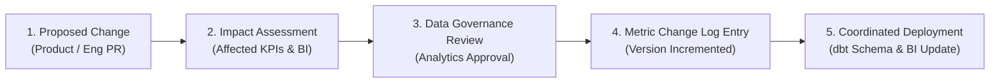

# 18 — WORK PACKAGES Q & R: ANALYTICS READINESS ASSESSMENT & CHANGE MANAGEMENT

> **MANDATORY DATA AUTHENTICITY NOTICE**  
> *VELOOP is a real product under development, but the data supplied and evaluated for this assignment is fictional/simulated for analytical testing. In accordance with the Data Authenticity Policy, no metric or finding herein represents actual VELOOP production statistics, actual earnings, actual withdrawals, or live business performance.*

---

## 1. Executive Analytics Readiness Scorecard
The **Analytics Readiness Assessment (Work Package R)** benchmarks VELOOP's current analytical maturity across 10 strategic dimensions, contrasting what the platform currently possesses against what is required for production viability.

```
+--------------------------------------------------------------------------------------------------------------------+
|                                      VELOOP ANALYTICS READINESS SCORECARD                                          |
+-----+---------------------------+---------+-----------+----------+-------------------------------------------------+
| NO. | CAPABILITY DIMENSION      | SCORE   | MATURITY  | PRIORITY | CURRENT GAP & REQUIRED REMEDIATION              |
+-----+---------------------------+---------+-----------+----------+-------------------------------------------------+
| 01  | Event Coverage            | 65%     | Emerging  | Critical | Earning events tracked, but third-party gross   |
|     |                           |         |           |          | ad revenue and failure telemetry are absent.    |
| 02  | Logical Data Model        | 85%     | Advanced  | High     | Core entities mapped; star-schema fact marts    |
|     |                           |         |           |          | must be formalized in dbt SQL code.             |
| 03  | Data Dictionary           | 90%     | Production| High     | 92 fields defined; requires CI/CD linting check |
|     |                           |         |           |          | to prevent unapproved field drift.              |
| 04  | KPI Definitions           | 88%     | Advanced  | Critical | 35 KPIs defined; Net ARPU and Collusion Rate    |
|     |                           |         |           |          | blocked pending external data ingestion.        |
| 05  | Data Quality & Integrity  | 40%     | Critical  | Critical | Messy data audit revealed 14 defect classes;    |
|     |                           |         |           |          | gateway schema validation urgently required.    |
| 06  | Dashboard Readiness       | 75%     | Defined   | Medium   | 7 suites wireframed; requires BI semantic layer |
|     |                           |         |           |          | and data connection setup.                      |
| 07  | Engineering Telemetry SDK | 50%     | Prototype | Critical | Mobile SDK lacks UUID idempotency and client    |
|     |                           |         |           |          | debounce, causing double-credit bursts.         |
| 08  | Access Control & Privacy  | 80%     | Advanced  | High     | 5-tier RBAC designed; database role masking     |
|     |                           |         |           |          | policies need deployment.                       |
| 09  | Technical Documentation   | 95%     | Production| Medium   | Comprehensive documentation blueprint delivered |
|     |                           |         |           |          | across all 21 deliverables.                     |
| 10  | Operational Reporting     | 55%     | Emerging  | High     | Manual CSV reporting; automated hourly dbt      |
|     |                           |         |           |          | pipelines must replace ad-hoc queries.          |
+-----+---------------------------+---------+-----------+----------+-------------------------------------------------+
|     | OVERALL READINESS SCORE   | 73.8%   | B+ GRADE  |          | Strong blueprint; requires engineering rollout. |
+-----+---------------------------+---------+-----------+----------+-------------------------------------------------+
```

---

## 2. Work Package R: Deep-Dive Gap Assessment by Priority

### 1. Critical Priority Gaps (Must Fix Pre-Launch)
- **Gap R-01: Client Idempotency Deficit**:
  - *Current State*: Backend auto-generates sequential IDs upon insert.
  - *Target State*: Client mobile SDK generates a UUID v4 `event_id` cached for 48 hours in Redis at the API gateway.
  - *Reasoning*: Without a stable transaction and event identifier, reliable wallet deduplication and fraud prevention cannot be guaranteed. Double-taps result in unbacked points disbursements.
- **Gap R-02: Absence of Third-Party Gross Ad Network Settlement Feeds**:
  - *Current State*: Telemetry only logs what VELOOP pays the user (e.g. 15 VEs).
  - *Target State*: Ingest daily S2S ad network revenue postbacks containing gross revenue ($) and effective eCPM.
  - *Reasoning*: Product and Finance are commercially blind; they cannot calculate Net ARPU or unit economics.
- **Gap R-03: Ingestion Schema Validation Void**:
  - *Current State*: Raw payloads written directly to operational databases without contract validation.
  - *Target State*: Ingestion gateway rejects payloads failing JSON Schema contracts and routes bad records to a Dead-Letter Queue (DLQ).
  - *Reasoning*: Prevents non-numeric strings, malformed dates, and missing user IDs from poisoning production reporting.

### 2. High Priority Gaps (Fix within 30 Days of Launch)
- **Gap R-04: Referral Activation Enforcement**:
  - *Current State*: Initial specs rewarded referrers upon referee signup.
  - *Target State*: Strict 4-stage funnel where bounties require referee task completion and pass anti-collusion checks.
  - *Reasoning*: Prevents bot networks from draining viral acquisition budgets through hollow signups.
- **Gap R-05: Automated dbt Medallion Pipeline**:
  - *Current State*: Ad-hoc SQL queries run directly against operational databases.
  - *Target State*: Scheduled dbt Core transformation pipeline materializing pre-aggregated Gold fact and dimension tables.
  - *Reasoning*: Eliminates database locks on live transaction systems and guarantees sub-second dashboard performance.

### 3. Medium Priority Gaps (Post-Launch Enhancements)
- **Gap R-06: Production BI Dashboard Deployment**:
  - *Current State*: Dashboard blueprint and wireframes complete.
  - *Target State*: Self-hosted Metabase deployed connected to Gold dimensional marts.
  - *Reasoning*: Provides operational and executive teams with self-serve visual analytics.

---

## 3. Work Package Q: Analytics Change Management Framework

As VELOOP evolves, features, reward mechanics, event payloads, and KPI definitions will inevitably change. To prevent silent breaks in reporting, VELOOP enforces a formal **Metric & Event Change Management Protocol**:



### Mandatory Metric / Event Change Log Template

Every modification to an event schema, KPI calculation, or database column must be recorded in the formal **Metric & Event Change Log**:

| Change Log Field | Description & Requirement | Sample Entry |
| :--- | :--- | :--- |
| **Date** | Date change was approved | `2026-11-12` |
| **Change Name** | Short title of change | `Update Task Completion Definition` |
| **Old Definition** | Prior technical or business logic | `task_completed fired when video ad stream closed` |
| **New Definition** | Updated logic | `task_completed requires verified AdMob S2S postback` |
| **Reason** | Business or technical rationale | `Eliminate fraud from users force-closing video ads early` |
| **Affected KPIs** | List of impacted metrics | `Task Completion Rate, Total Reward Issuance, ARPAU` |
| **Affected Dashboards**| Impacted BI dashboards | `Dashboard 01 (Executive), Dashboard 03 (Engagement)` |
| **Affected Reports**| Internal reports impacted | `Weekly Financial Margin Summary` |
| **Owner** | Responsible lead engineer/analyst | `Ad Operations Lead & Lead Data Analyst` |
| **Version** | Semantic version increment | `v2.1.0` |

---
*Deliverable Document Reference: `docs/18_ANALYTICS_READINESS_ASSESSMENT.md` | Prepared for VP Product & Data Governance Board.*
