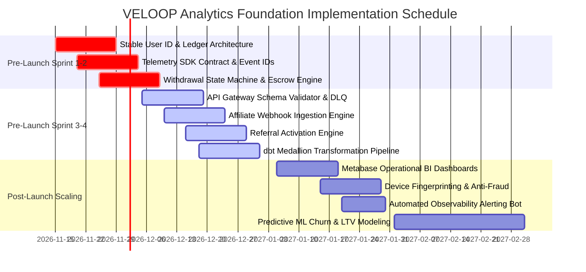

# 20 — WORK PACKAGE 26: FINAL IMPLEMENTATION BACKLOG

> **MANDATORY DATA AUTHENTICITY NOTICE**  
> *VELOOP is a real product under development, but the data supplied and evaluated for this assignment is fictional/simulated for analytical testing. In accordance with the Data Authenticity Policy, no metric or finding herein represents actual VELOOP production statistics, actual earnings, actual withdrawals, or live business performance.*

---

## 1. Executive Backlog Mandate & Prioritization Matrix
The **Final Implementation Backlog (Work Package 26)** translates the analytical blueprint into an actionable, prioritized engineering backlog. Tasks are sequenced into two primary deployment horizons: **Pre-Launch (Foundational Integrity & Zero-Loss Ingestion)** and **Post-Launch (BI Scaling, Advanced Modeling & Automation)**.

- **Primary Data File**: `deliverables_tables/20_IMPLEMENTATION_BACKLOG.csv`
- **Total Backlog Items**: 12 High-Impact Technical Epics
- **Prioritization Logic**:
  - `Critical`: Core financial integrity, idempotency, and referential identity blockers. Must deploy prior to public launch.
  - `High`: Core product measurement, data quality filtering, and attribution. Must deploy prior to scaling marketing.
  - `Medium`: Executive operational dashboards and fraud detection models.
  - `Low`: Machine learning optimization and automated LTV bidding.

---

## 2. Complete Prioritized Implementation Backlog Table

| Priority | Requirement / Technical Epic | Rationale & Analytical Impact | Technical Dependency | Responsible Owner | Deployment Stage |
| :--- | :--- | :--- | :--- | :--- | :--- |
| **Critical** | Implement Stable Surrogate `user_id` across all microservices and telemetry | Required for cross-event analysis, user identity resolution, and referential integrity across devices. | Auth Service Architecture | Core Backend Team | Pre-launch |
| **Critical** | Deploy Double-Entry Ledger `transaction_id` with Idempotency Constraints | Guarantees transactional integrity, eliminates balance discrepancies, and prevents duplicate credits. | Core Ledger Architecture | Ledger / Backend Engineering | Pre-launch |
| **Critical** | Standardize Event Tracking SDK with Mandatory `event_id` and ISO Timestamps | Eliminates malformed dates, missing timestamps, and rapid client duplicate bursts. | Mobile Telemetry SDK | Mobile App / Data Platform | Pre-launch |
| **Critical** | Build Withdrawal State Machine Enforcing Strict State Transitions | Prevents impossible transitions (completed prior to requested) and ensures escrow balance synchronization. | Withdrawal Engine | Payment Engineering | Pre-launch |
| **High** | Implement Ingestion Gateway Data Quality Filter & Quarantine DLQ | Intercepts invalid statuses, non-numeric values, and un-trimmed strings before database landing. | API Gateway / Kafka Broker | Data Engineering | Pre-launch |
| **High** | Instrument Server-to-Server Affiliate Webhook Ingestion Pipeline | Captures partner postbacks for surveys and offerwalls with validation verification and signature checking. | Partner Ad Integrations | Ad Operations / Backend | Pre-launch |
| **High** | Establish Referral Attribution & Anti-Fraud Conversion Engine | Enforces distinction between registration and activation; prevents self-referral bot rings. | Deep-Link Routing SDK | Growth Engineering | Pre-launch |
| **High** | Build Automated dbt Transformation Pipeline for Medallion Layers (Bronze/Silver/Gold)| Automates cleansing, case normalization, and aggregate KPI modeling for BI reporting. | Analytical Data Warehouse | Analytics Engineering | Pre-launch |
| **Medium** | Deploy Core Operational BI Dashboards (Executive, Earning, Withdrawals) | Provides executive leadership and product managers with real-time operational health visibility. | Gold Layer Data Models | BI / Analytics Team | Post-launch |
| **Medium** | Implement Hardware Device Fingerprinting & Proxy Detection Telemetry | Required for advanced multi-account collusion detection and sybil attack mitigation. | Security SDK Integration | Fraud / Security Team | Post-launch |
| **Medium** | Build Automated Data Quality Alerting Bot on Metric Anomalies | Notifies on-call engineers when event drop-offs, reversals, or queue backlogs exceed standard deviations. | Observability Infrastructure | Data Platform Team | Post-launch |
| **Low** | Develop Machine Learning Predictive Churn and Lifetime Value (LTV) Models | Optimizes user acquisition bidding, personalized bonus mechanics, and win-back push notifications. | 6 Months of Production Data | Data Science Team | Post-launch |

---

## 3. Sprint Execution Roadmap

---
*Deliverable Document Reference: `docs/20_IMPLEMENTATION_BACKLOG.md` | Data File: `deliverables_tables/20_IMPLEMENTATION_BACKLOG.csv`.*
